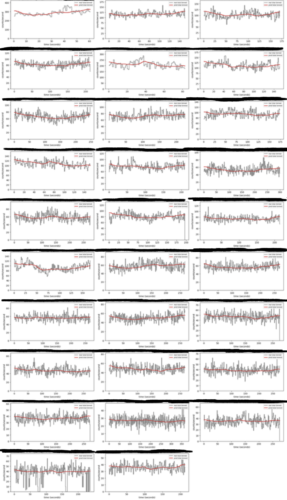

# PPAD: Poisson Process AutoDecoder

🚧 **Work in progress.** This project is still under development.

## About

PPAD is an autodecoder for X-ray source data. It learns a small latent vector for each X-ray event file and uses a neural network (the decoder) to turn that latent into a light curve, which is how the photon rate changes over time. The decoder gives a **continuous light curve**, so it can be evaluated at any time point without binning the data.

These learned latent vectors are compact representations of each source. Sources with similar behavior end up with similar latents that sit close together, which makes studying them much easier for researchers: similar sources can be found and grouped together, and unusual ones stand out. The latents are also useful for downstream tasks such as regression, classification and anomaly detection.

## Architecture

- **Input:** an 8-dimensional latent vector plus a positional encoding (PE) of time
- **Positional encoding:** time is passed through sine and cosine functions at increasing frequencies (12 frequencies, giving a 25-dimensional vector together with the normalized time), so the network can learn both slow variations and sharp transients
- **Decoder:** a ResNet with 5 blocks (width 512)
- **Output:** the photon rate at 3 energy bands (soft, medium, hard), as a continuous light curve
- **Loss:** Poisson likelihood + total variation penalty + latent norm penalty

## Status

- ✅ Decoder trained successfully
- The decoder is learning useful information and performs very well, even when new, unseen sources come up.

## Results

Predicted light curves compared with the real binned data on unseen event files. We trained the decoder on a set of X-ray sources and then tested it on completely new sources that it had never seen before.

In each plot, the **gray** line is the real binned counts and the **red** line is the decoder's predicted rate (counts/second over time in seconds). The data is binned only for the gray line; the predicted light curve is continuous and not binned.

Sample result:



More results are in the [`unseen/`](unseen/) folder.

## Repository structure

```
.
├── README.md
└── unseen/    # result plots on unseen event files
```

## Acknowledgements

Inspired by the work of Song, Villar, Martínez-Galarza & Dillmann (2025). The X-ray data and everything else in this project are different, as the telescope is completely different.
